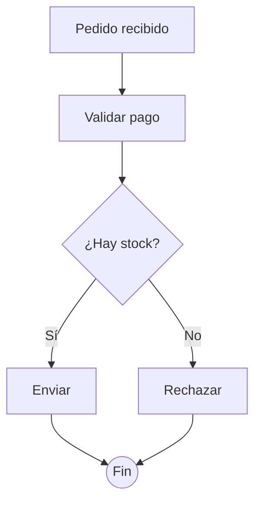

# SPEC — Tool `diagram`

Prioridad: P2 (interfaz)

## Propósito

Permitir que el modelo genere diagramas de flujo a partir de código Mermaid y los muestre
en la TUI como un bloque visual dentro de la conversación, sin salir de la terminal ni
depender de navegador, SVG ni imagen. El bloque es texto Unicode con caracteres de dibujo
de caja, no ASCII puro ni una imagen.

## Alcance

Incluye:

- Una herramienta nueva `diagram` con un único parámetro obligatorio `code`, cuyo valor es
  texto Mermaid. La llamada es un JSON con ese único campo; no se admite un grafo JSON de
  nodos y conexiones ni parámetros separados para cada parte del diagrama.
- Un **subconjunto** de Mermaid flowchart: nodos con ID y texto, formas básicas
  (rectángulo, decisión, elipse), conexiones dirigidas con flecha, etiquetas de
  conexión, orientación `TD` y `LR`, múltiples ramas y destinos compartidos.
- Una representación intermedia (IR) entre parser y presentación, para poder probar cada
  parte por separado.
- Un motor de layout por niveles con compactación al espacio disponible de la TUI.
- Un renderizador Unicode que convierta la IR en caracteres de ancho calculado.
- La presentación del resultado como bloque diferenciado del texto del asistente en el
  hilo del chat.
- Errores estructurados que el modelo pueda leer y corregir en la misma pasada.

No incluye:

- El lenguaje Mermaid completo (secuencias, clases, Gantt, etc.).
- Renderizado de imagen, SVG, ni salida a navegador.
- Parámetros obligatorios adicionales (`titulo`, `orientación`, etc.): la orientación sale
  del propio código y el título, si acaso, se deriva de la definición.
- Cambios en la base de datos: la herramienta no persiste estado propio.
- Bucles de reintento autónomos: el reintento es del modelo, dentro del máximo de pasadas
  ya definido en [[specs/SPEC-TOOLS]].

## Actores

- **Agente `plan`**: genera diagramas para explicar o proponer (permiso `read`).
- **Agente `build`**: genera diagramas durante la construcción (permiso `read`).
- **Sistema**: valida los argumentos, interpreta el Mermaid, calcula el layout, renderiza
  y entrega el resultado a la TUI.
- **Usuario**: ve el diagrama en el hilo y lo compara con el texto de la conversación.

## Flujo principal

1. El modelo pide `diagram` con una llamada de herramienta cuyo único argumento es `code`
   —un string con el código Mermaid—. La llamada viaja como JSON (`{"code": "..."}`), pero
   el diagrama es texto Mermaid dentro de `code`, no una estructura de nodos y conexiones.
2. La capa universal valida los argumentos contra el esquema (igual que el resto de
   herramientas) y comprueba el permiso.
3. El parser interpreta el subconjunto admitido y construye la IR: nodos, formas,
   conexiones, etiquetas y orientación.
4. El motor de layout asigna niveles, evita solapamientos, reserva espacio para
   etiquetas y adapta el conjunto al ancho y alto disponibles.
5. El renderizador convierte la IR posicionada en líneas Unicode (bordes, flechas,
   formas, textos) respetando el ancho de columna real de cada carácter.
6. El handler devuelve el resultado; el mecanismo de eventos presenta el diagrama en la
   conversación como bloque visual, diferenciado de un mensaje de texto normal.
7. El texto de la respuesta del agente y las demás herramientas no cambian de formato.

## Flujos alternativos

- **Entrada vacía o `code` ausente.** Error corregible con la categoría, sin procesar nada.
- **Sintaxis fuera del subconjunto.** Error con línea y posición aproximadas, el elemento
  problemático y un ejemplo de sintaxis válida.
- **Directiva no soportada** (p. ej. `sequenceDiagram`). Error que indica qué se admite.
- **Referencia a nodo inexistente, definición contradictoria o conexión inválida.** Error
  explícito: nunca se ignora el elemento ni se devuelve un diagrama aparentemente válido
  con relaciones perdidas.
- **Límite excedido** (tamaño de código, número de nodos/conexiones, longitud de
  etiquetas, dimensiones de la IR). Error o advertencia explícita según el caso, siguiendo
  las convenciones de error del harness.
- **Sin representación legible en el espacio disponible.** Se informa de la limitación en
  lugar de truncar silenciosamente.
- **Fallo del renderizado.** Queda aislado: la conversación y el resto del turno siguen
  funcionando; el error vuelve por el protocolo de herramientas.

## Sintaxis admitida (subconjunto Mermaid)

| Construcción | Ejemplo | Notas |
|---|---|---|
| Cabecera | `flowchart TD` / `flowchart LR` | `TD` vertical (por defecto), `LR` horizontal |
| Nodo rectángulo | `A[Texto]` | forma por defecto |
| Nodo decisión | `C{¿Pregunta?}` | rombo |
| Nodo elipse | `B((Texto))` | inicio/fin |
| Conexión con flecha | `A --> B` | dirigida |
| Conexión etiquetada | `C -->\|Sí\| D` | etiqueta entre barras verticales |
| Definición y conexión en una línea | `A[Uno] --> B[Dos]` | ambos nodos creados |
| IDs repetidos | `A[X] ... A[Y]` | mismo nodo: se rechaza si el texto/ forma contradice |

Todo lo demás (otros tipos de flecha, estilos `classDef`, subgraphs, comentarios
avanzados, nodos sin definir con forma, etc.) está fuera del alcance inicial y debe
producir un error explícito, no una omisión silenciosa.

## Ejemplo completo

Petición del usuario:

> «Explícame qué pasa cuando llega un pedido y no hay stock, y hazme un diagrama.»

El modelo razona el flujo (razonamiento ilustrativo, no forma parte del contrato):

> El usuario quiere entender el flujo y verlo. Uso `diagram` con un flowchart `TD`:
> pedido recibido → validar pago → decisión de stock → enviar o rechazar → fin.

Y llama a la herramienta con un único argumento `code`:

```json
{
  "name": "diagram",
  "arguments": {
    "code": "flowchart TD\n    A[Pedido recibido] --> B[Validar pago]\n    B --> C{¿Hay stock?}\n    C -->|Sí| D[Enviar]\n    C -->|No| E[Rechazar]\n    D --> F((Fin))\n    E --> F"
  }
}
```

El valor de `code`, ya legible, es el Mermaid que interpreta el parser:



La herramienta valida el argumento, construye la IR, calcula el layout y renderiza el
bloque. El resultado que recibe el modelo y que la TUI pinta bajo la línea de la
herramienta tiene esta forma (los glifos exactos dependen del renderizador):

```
┌─────────────────┐
│ Pedido recibido │
└────────┬────────┘
         ▼
┌─────────────────┐
│ Validar pago    │
└────────┬────────┘
         ▼
    ╱────────────╲
   ╱ ¿Hay stock?  ╲
   ╲              ╱
    ╲────────────╱
      │Sí      │No
      ▼        ▼
┌──────────┐ ┌───────────┐
│ Enviar   │ │ Rechazar  │
└────┬─────┘ └─────┬─────┘
     └──────┬──────┘
            ▼
         (( Fin ))
```

En la conversación, la línea sigue el patrón habitual (`DIAGRAMAR [...] · N líneas ·
tiempo`) y el bloque se dibuja debajo, como contenido adicional. El JSON de la llamada
**no contiene `nodes` ni `edges`**: el grafo se deduce del texto Mermaid. El modelo recibe
ese mismo bloque como resultado de la herramienta y cierra el turno con la explicación en
prosa; no necesita repetir el diagrama.

## Arquitectura (responsabilidades separadas)

1. **Tool** — `internal/tools`: entrada, validación de argumentos, integración con el
   catálogo y con el ciclo de ejecución.
2. **Parser** — interpreta el subconjunto admitido y construye la IR.
3. **IR** — nodos (ID, texto, forma), conexiones (origen, destino, etiqueta opcional),
   orientación y posiciones/dimensiones calculadas.
4. **Layout** — distribución por niveles; detecta ciclos para no buclear; compacta al
   espacio disponible sin eliminar información semántica.
5. **Renderizador TUI** — IR posicionada → líneas Unicode, con ancho de columna real
   (`runewidth`), tolerante a textos largos, Unicode y redimensionamiento.
6. **Integración** — entrega al sistema de mensajes/render de la TUI, sin que parser ni
   layout toquen el estado de la interfaz.

Cada parte es testeable por separado: parser contra código, layout contra IR, render
contra IR posicionada, e integración contra el ciclo real de herramientas.

## Presentación en la conversación

- El diagrama aparece como bloque visual propio en el hilo, separado del texto normal
  del asistente, en la zona de chat ([[specs/SPEC-INTERFAZ]] §Zonas 1).
- Se reutiliza el mecanismo existente de eventos de herramienta; si el payload actual
  (`herramienta_resultado` sin salida) no basta, se extiende de forma mínima para
  transportar el bloque, sin alterar el formato de los demás mensajes.
- El resultado también vuelve al modelo por el protocolo de herramientas normal: el bloque
  renderizado en texto, para que pueda leerlo, citarlo o corregir errores.
- La línea de la herramienta en el hilo sigue el patrón actual (`VERBO [tema] · medida ·
  tiempo`); el bloque es adicional, no un sustituto de la línea.

## Errores y recuperación

Convención: los errores siguen el formato de errores corregibles del harness
(categoría + mensaje), con la mayor información posible:

- Categoría del error.
- Línea y posición aproximadas dentro del código.
- Elemento o sintaxis problemática.
- Explicación breve.
- Ejemplo o indicación de sintaxis válida.

Casos contemplados: código vacío/ausente, sintaxis inválida, directivas no soportadas,
nodos duplicados contradictorios, referencias inexistentes, formas/conexiones inválidas,
límites excedidos, fallos de layout o render. El error se devuelve por el protocolo
existente para que el modelo lo lea e intente corregirlo en la misma pasada, sin bucles
autónomos nuevos.

## Límites adaptativos

Valores de partida (moderados, ajustables tras medir la TUI real):

- Tamaño máximo del código: ~8 KB.
- Nodos: hasta ~50; conexiones: hasta ~100.
- Longitud de etiquetas/textos: recorte con aviso, nunca silencioso.
- Dimensiones de la IR limitadas; layout compactado al ancho/alto actuales de la TUI.

Regla superior: la adaptación visual nunca elimina información semántica. Si no cabe
nada legible, se devuelve error/advertencia explícita en lugar de truncar.

## Seguridad y robustez

- El código Mermaid es entrada no confiable: no se ejecuta, no abre archivos, red ni
  comandos.
- Sin regex de backtracking peligroso; validación de argumentos antes de procesar.
- Sin panics ni bloqueos de la TUI ante entradas inválidas; los fallos de render quedan
  aislados del resto de la conversación.

## Criterios de aceptación

- [ ] El modelo invoca `diagram` con el mecanismo de tools existente y `code` como único
      parámetro obligatorio.
- [ ] La descripción de la herramienta es breve, explícita y lleva un ejemplo de
      invocación válido, pensada para modelos locales pequeños.
- [ ] La llamada de §Ejemplo completo —un JSON con `code` y el Mermaid dentro— produce el
      diagrama descrito, sin parámetros `nodes`/`edges`.
- [ ] El subconjunto documentado de Mermaid se convierte en una IR válida.
- [ ] El layout por niveles funciona en `TD` y `LR`, con ramas y destinos compartidos,
      detectando ciclos sin bucles infinitos.
- [ ] El diagrama se ve en la conversación, como bloque diferenciado del texto.
- [ ] Conexiones, etiquetas y formas se representan correctamente con Unicode.
- [ ] La compactación reduce espacios sin eliminar nodos, etiquetas ni conexiones; si no
      cabe, se informa.
- [ ] Los errores incluyen categoría, posición y ejemplo de sintaxis válida, y llegan al
      modelo por el protocolo de herramientas.
- [ ] Las entradas inválidas no rompen el harness ni la TUI.
- [ ] Las pruebas existentes siguen pasando.
- [ ] La documentación describe la sintaxis admitida y sus limitaciones.
- [ ] `plan` y `build` pueden usar la herramienta (permiso `read`).

## Requisitos no funcionales

- Render sin dependencias nuevas de navegador, imagen ni sistema.
- Ancho de columna real de Unicode calculado (nunca asumir 1 columna por carácter).
- Tolerante a terminales estrechas y redimensionables.

## Dependencias funcionales

- [[specs/SPEC-TOOLS]]
- [[specs/SPEC-INTERFAZ]]

## Supuestos

- Los límites concretos (KB, nodos, dimensiones) se confirman tras inspeccionar el ancho
  y alto reales de la TUI.
- El mecanismo de extensión del evento `herramienta_resultado` se define en la fase de
  integración, como extensión mínima.

## Referencias

- [[IDEA]]
- [[specs/SPEC-TOOLS]]
- [[backend/02-interfaces/TOOLS]]
